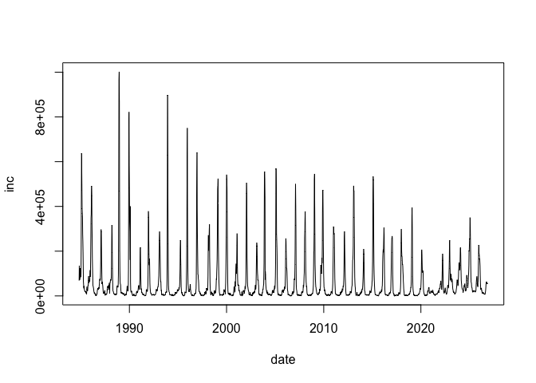
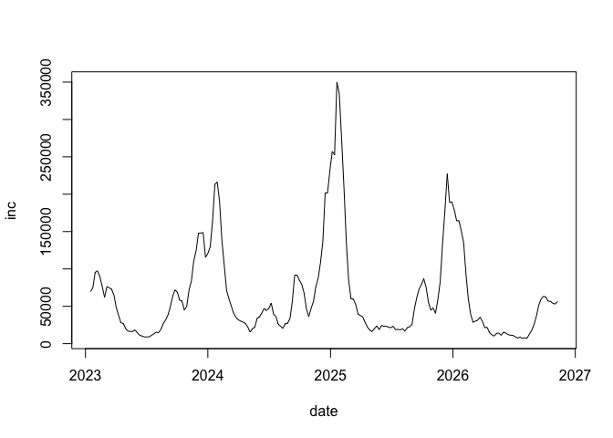
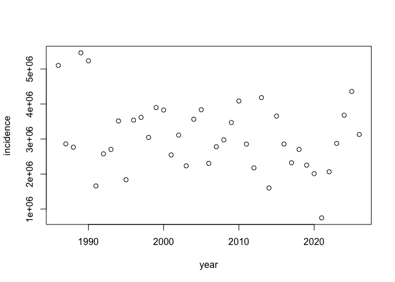
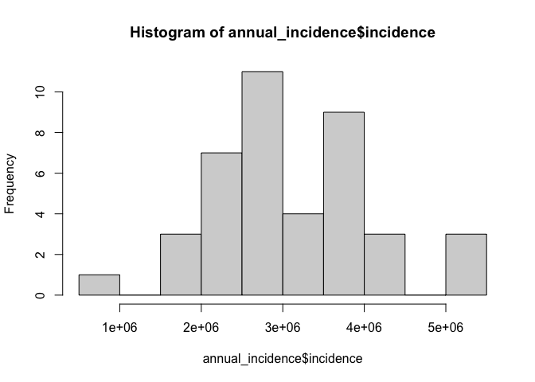

influenza-case-study
================
Ruxandra Iliescu
2026-11-21

``` r
data_url = "https://www.sentiweb.fr/datasets/all/inc-3-PAY.csv"
```

2194 observations, corresponding to approximately 42.2 years (1984-2026)

``` r
data = read.csv(data_url, skip=1)
head(data)
```

    ##     week indicator   inc inc_low inc_up inc100 inc100_low inc100_up geo_insee
    ## 1 202646         3 56476   49192  63760     84         73        95        FR
    ## 2 202645         3 53040   46755  59325     79         70        88        FR
    ## 3 202644         3 54053   46793  61313     80         69        91        FR
    ## 4 202643         3 56521   47703  65339     84         71        97        FR
    ## 5 202642         3 57043   49964  64122     85         74        96        FR
    ## 6 202641         3 62204   55044  69364     92         81       103        FR
    ##   geo_name
    ## 1   France
    ## 2   France
    ## 3   France
    ## 4   France
    ## 5   France
    ## 6   France

``` r
tail(data)
```

    ##        week indicator    inc inc_low inc_up inc100 inc100_low inc100_up
    ## 2189 198449         3 101073   81684 120462    184        149       219
    ## 2190 198448         3  78620   60634  96606    143        110       176
    ## 2191 198447         3  72029   54274  89784    131         99       163
    ## 2192 198446         3  87330   67686 106974    159        123       195
    ## 2193 198445         3 135223  101414 169032    246        184       308
    ## 2194 198444         3  68422   20056 116788    125         37       213
    ##      geo_insee geo_name
    ## 2189        FR   France
    ## 2190        FR   France
    ## 2191        FR   France
    ## 2192        FR   France
    ## 2193        FR   France
    ## 2194        FR   France

second parameter = 1 specifies to traverse the dataset line by line the
function returns true if any column of the observation has a missing
value it’s the same observation as in the mooc, no new ones

``` r
na_lines = apply(data, 1, function(x) any(is.na(x)))
data[na_lines,]
```

    ##        week indicator inc inc_low inc_up inc100 inc100_low inc100_up geo_insee
    ## 1958 198919         3   -      NA     NA      -         NA        NA        FR
    ##      geo_name
    ## 1958   France

``` r
class(data$week)
```

    ## [1] "integer"

specifies data type `character` for the `inc` (incidence) column due to
the missing value

``` r
class(data$inc)
```

    ## [1] "character"

now that we know how the missing values are marked, reload the data and
skip those observations (only one in this case) the `inc` column is now
saved as the `integer` type

``` r
data = read.csv(data_url, skip=1, na.strings = "-")
class(data$inc)
```

    ## [1] "integer"

``` r
library(parsedate)
```

``` r
convert_week = function(date) {
  ws = paste(date) # type - character
  iso = paste0(substring(ws, 1, 4), "-W", substring(ws, 5, 6))
  as.character(parse_iso_8601(iso)) # returns the first day of the week
}
```

``` r
data$date = as.Date(sapply(data$week, convert_week))
```

``` r
class(data$date)
```

    ## [1] "Date"

``` r
head(data)
```

    ##     week indicator   inc inc_low inc_up inc100 inc100_low inc100_up geo_insee
    ## 1 202646         3 56476   49192  63760     84         73        95        FR
    ## 2 202645         3 53040   46755  59325     79         70        88        FR
    ## 3 202644         3 54053   46793  61313     80         69        91        FR
    ## 4 202643         3 56521   47703  65339     84         71        97        FR
    ## 5 202642         3 57043   49964  64122     85         74        96        FR
    ## 6 202641         3 62204   55044  69364     92         81       103        FR
    ##   geo_name       date
    ## 1   France 2026-11-09
    ## 2   France 2026-11-02
    ## 3   France 2026-10-26
    ## 4   France 2026-10-19
    ## 5   France 2026-10-12
    ## 6   France 2026-10-05

``` r
data = data[order(data$date),]
head(data)
```

    ##        week indicator    inc inc_low inc_up inc100 inc100_low inc100_up
    ## 2194 198444         3  68422   20056 116788    125         37       213
    ## 2193 198445         3 135223  101414 169032    246        184       308
    ## 2192 198446         3  87330   67686 106974    159        123       195
    ## 2191 198447         3  72029   54274  89784    131         99       163
    ## 2190 198448         3  78620   60634  96606    143        110       176
    ## 2189 198449         3 101073   81684 120462    184        149       219
    ##      geo_insee geo_name       date
    ## 2194        FR   France 1984-10-29
    ## 2193        FR   France 1984-11-05
    ## 2192        FR   France 1984-11-12
    ## 2191        FR   France 1984-11-19
    ## 2190        FR   France 1984-11-26
    ## 2189        FR   France 1984-12-03

``` r
all(diff(data$date) == 7)
```

    ## [1] TRUE

``` r
with(data, plot(date, inc, type="l"))
```

<!-- -->
the year label falls exactly under January 1

``` r
with(tail(data, 200), plot(date, inc, type="l"))
```

<!-- -->

# Answering questions with our data

Q1: When did the biggest outbreaks occur?

``` r
annual_peak = function(year) {
  debut = paste0(year-1, "-08-01")
  end = paste0(year, "-08-01")
  weeks = data$date > debut & data$date <= end
  sum(data$inc[weeks], na.rm = TRUE) 
}
```

``` r
years = 1986:2026
```

``` r
annual_incidence = data.frame(year = years,
                              incidence = sapply(years, annual_peak))
```

``` r
head(annual_incidence)
```

    ##   year incidence
    ## 1 1986   5100540
    ## 2 1987   2861556
    ## 3 1988   2766142
    ## 4 1989   5460155
    ## 5 1990   5233987
    ## 6 1991   1660832

``` r
tail(annual_incidence)
```

    ##    year incidence
    ## 36 2021    748872
    ## 37 2022   2064994
    ## 38 2023   2875530
    ## 39 2024   3681166
    ## 40 2025   4358437
    ## 41 2026   3130516

``` r
plot(annual_incidence, type="p")
```

<!-- -->

``` r
head(annual_incidence[order(-annual_incidence$incidence),])
```

    ##    year incidence
    ## 4  1989   5460155
    ## 5  1990   5233987
    ## 1  1986   5100540
    ## 40 2025   4358437
    ## 28 2013   4182265
    ## 25 2010   4085126

``` r
hist(annual_incidence$incidence, breaks = 10)
```

<!-- -->
